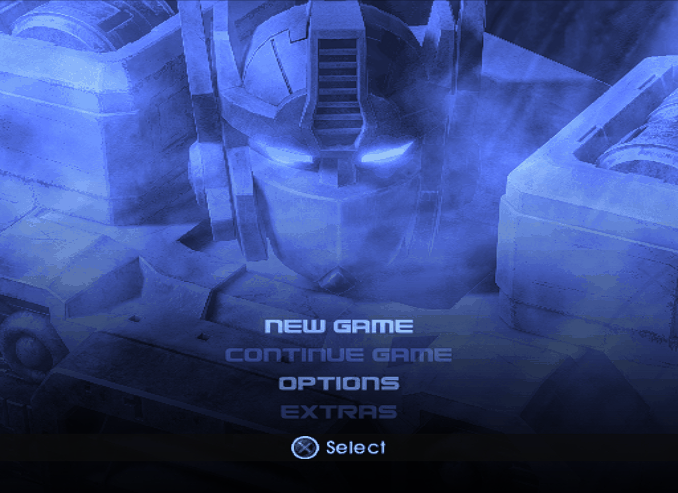

# Transformers (PS2) for Linux

Play *Transformers* (Melbourne House / Atari, 2004) natively on Linux. This is
not an emulator: the game's PlayStation 2 code is translated to native code
from **your own disc** and runs on a re-implementation of the PS2 hardware it
uses. Every mission plays, at or near the game's 30 fps cap on a mid-range PC.



## What you need

**Your own copy of the game**, as a disc image (`.iso`):

| | |
|---|---|
| Title | *Transformers* (USA), PlayStation 2 |
| Serial | **SLUS-20668** (NTSC-U) |
| Works | the US release only |
| Doesn't work | PAL/European (SLES-52388), Japanese, other versions |

You don't need to know which one you have: the setup wizard checks the disc
and tells you. No game files are included here, and none are downloaded.

**A PC with:**

* Linux on x86-64, with glibc 2.35 or newer (Ubuntu 22.04, Fedora 36,
  Debian 12, Arch, or anything newer)
* A CPU with AVX2 (Intel Haswell / AMD Ryzen or newer)
* A GPU driver with OpenGL 4.5
* 3 GB of free disk space and 4 GB of RAM for the one-time setup

## Play

1. Download `Transformers-x86_64.AppImage` from the
   [Releases page](https://github.com/kadraa-png/transformers-ps2-linux/releases).
2. Make it executable: right-click → Properties → "Allow executing as
   program", or in a terminal:
   ```sh
   chmod +x Transformers-x86_64.AppImage
   ```
3. Run it. The setup wizard finds your disc image (or you pick it), checks
   it, and builds the game for your PC once (10–20 minutes). After that,
   you get straight to **Play**.

The wizard can also add Transformers to your app menu. Saves go to
`~/.local/share/transformers-port/memcard0`.

## Controls

Keyboard and mouse and any SDL-supported gamepad work at the same time.

| Action | Keyboard / mouse | Gamepad |
|---|---|---|
| Move | W A S D | Left stick |
| Camera / aim | Mouse | Right stick |
| Fire primary / secondary | Left / right mouse button | R1 / R2 |
| Mini-Con slots | Q / E | L1 / L2 |
| Jump, confirm | Space | Cross (A) |
| Transform | F | Triangle (Y) |
| Pause | Escape or Enter | Start |
| Fullscreen | F11 | |

Click in the window to capture the mouse; Escape releases it. Full list:
[launcher/CONTROLS.md](launcher/CONTROLS.md), also shown under **Controls** in the
launcher.

## Build from source

You need GCC 13 or newer, CMake 3.20+, Ninja, Python 3 and the development
packages below.

**Arch / Manjaro / CachyOS**

```sh
sudo pacman -S --needed base-devel cmake ninja python git libx11 libxext libxrandr libxcursor \
  libxi libxss libxkbcommon wayland wayland-protocols mesa libglvnd libpulse pipewire alsa-lib \
  libpng zlib xz freetype2 glib2
```

**Ubuntu 24.04+ / Debian 13+**

```sh
sudo apt install build-essential cmake ninja-build python3 git pkg-config libx11-dev libxext-dev \
  libxrandr-dev libxcursor-dev libxi-dev libxss-dev libxkbcommon-dev libwayland-dev \
  wayland-protocols libegl-dev libgl-dev libpulse-dev libpipewire-0.3-dev libasound2-dev \
  libudev-dev libpng-dev zlib1g-dev liblzma-dev libfreetype-dev libglib2.0-dev libglib2.0-dev-bin
```

**Fedora**

```sh
sudo dnf install gcc-c++ cmake ninja-build python3 git pkgconf libX11-devel libXext-devel \
  libXrandr-devel libXcursor-devel libXi-devel libXScrnSaver-devel libxkbcommon-devel \
  wayland-devel wayland-protocols-devel mesa-libEGL-devel mesa-libGL-devel libglvnd-devel \
  pulseaudio-libs-devel pipewire-devel alsa-lib-devel systemd-devel libpng-devel zlib-devel \
  xz-devel freetype-devel glib2-devel
```

**Then:**

```sh
git clone https://github.com/kadraa-png/transformers-ps2-linux.git
cd transformers-ps2-linux

# SDL3, built once into third_party/install
git clone --depth 1 -b release-3.2.26 https://github.com/libsdl-org/SDL.git third_party/SDL3
cmake -S third_party/SDL3 -B third_party/SDL3/build -G Ninja -DCMAKE_BUILD_TYPE=Release \
      -DSDL_SHARED=OFF -DSDL_STATIC=ON -DSDL_TESTS=OFF -DCMAKE_INSTALL_PREFIX=$PWD/third_party/install
ninja -C third_party/SDL3/build install

# The game (reads your disc image at configure time)
cmake -S . -B build -G Ninja -DPS2_ISO="/path/to/Transformers (USA).iso"
ninja -C build transformers
./build/transformers "/path/to/Transformers (USA).iso"
```

`./build/transformers --help` lists the display options (renderer, upscale,
resolution, widescreen, fullscreen, mouse).

## Troubleshooting

**"This disc is SLES-52388" (or another serial).** Only the US release works;
see [What you need](#what-you-need).

**"Its files don't match the original disc."** The image is modified or
damaged. Make a fresh copy of your disc.

**The one-time build is slow or stops.** It compiles about 1.6 million
translated instructions; 10–20 minutes is normal, longer on 2-core machines.
If it fails, the launcher shows the end of the log, and **Retry** continues
where it stopped. Close other large programs if your PC has only 4 GB of RAM.

**Black window or the game won't start.** Check that your GPU driver
supports OpenGL 4.5 (`glxinfo | grep "core profile version"`). On very old
GPUs, choose the software renderer under **Settings** (accurate, but slower).

**Reporting a bug.** Open an issue with your distro, CPU and GPU, and attach
`~/.local/share/transformers-port/game-*/build.log` for build problems.

## Status

Boot, logos, movies, menus, memory-card saves, the Ark hub and all eight
missions run with the default OpenGL renderer. Measured on a 4-core i5-7400
with a GTX 1050 Ti (the game caps at 30 fps):

| Mission (warp gate) | avg fps |
|---|---|
| Amazon (Amazon Basin) | 28–30 |
| Amazon (Mountain Ruin) | ~29 |
| Antarctica (Research Center) | ~29.5 |
| Deep Amazon (Jungle Village) | ~28 |
| Mid-Atlantic (Pinnacle Rock) | ~30 |
| Alaska (Cliff-Top) | ~30 |
| Starship (Crash Site) | ~30 |
| Pacific Island (Volcano) | ~30 |
| Cybertron (Iacon City) | ~29 |

This isn't a finished project. The game is fully playable, but expect rough
edges, and expect updates that fix them. A **Windows release is planned** and
in progress; for now only Linux is supported.

## Known bugs

- **Some shader effects render wrong.** A few of the game's screen and
  surface effects look different from a real PS2 with the default OpenGL
  renderer.
- **Black patches in the skybox.** Parts of the sky can show as black areas
  in some missions.
- **Blue specks in distant trees (software renderer).** In Mountain Ruin the
  software renderer draws blue specks in faraway trees; the OpenGL renderer
  doesn't.
- **Mouse look in vehicle mode is less precise.** On foot the mouse turns the
  camera directly, but in vehicle mode it falls back to emulating the right
  stick, so it has the stick's turn-rate cap and ramp. A gamepad works as
  usual.
- **Occasional dips below 30 fps** in the heaviest scenes (Deep Amazon, parts
  of Amazon Basin), even on hardware that holds 30 elsewhere.

Found something else? See **Reporting a bug** under
[Troubleshooting](#troubleshooting).

## Credits and license

This project is free software under the GNU GPL, version 3 or later
([LICENSE](LICENSE)). It builds on GSdx, the VU/VIF interpreter, SPU2-X and
mpeg2lib from [PCSX2](https://pcsx2.net), on [SDL](https://libsdl.org) and on
[Dear ImGui](https://github.com/ocornut/imgui); see [NOTICE](NOTICE) for each
component's license.

Transformers is a trademark of Hasbro. The game was developed by Melbourne
House and published by Atari. This project is not affiliated with or endorsed
by any of them. The launcher's artwork is taken from the game and belongs to
its owners. No game code or data is included: you need your own disc.
